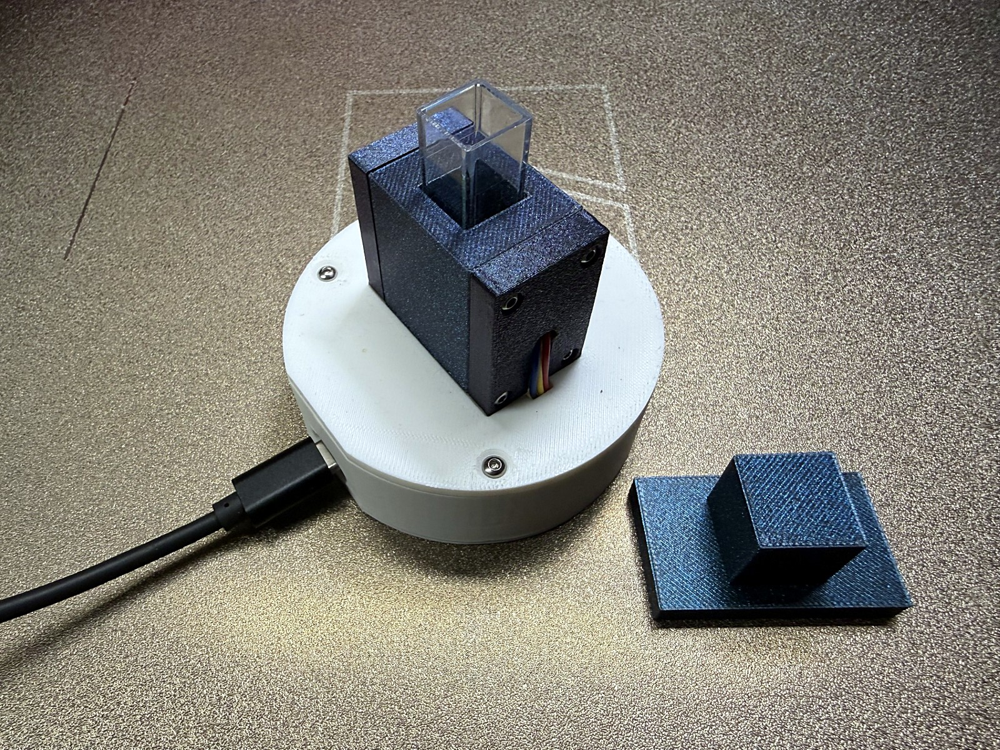
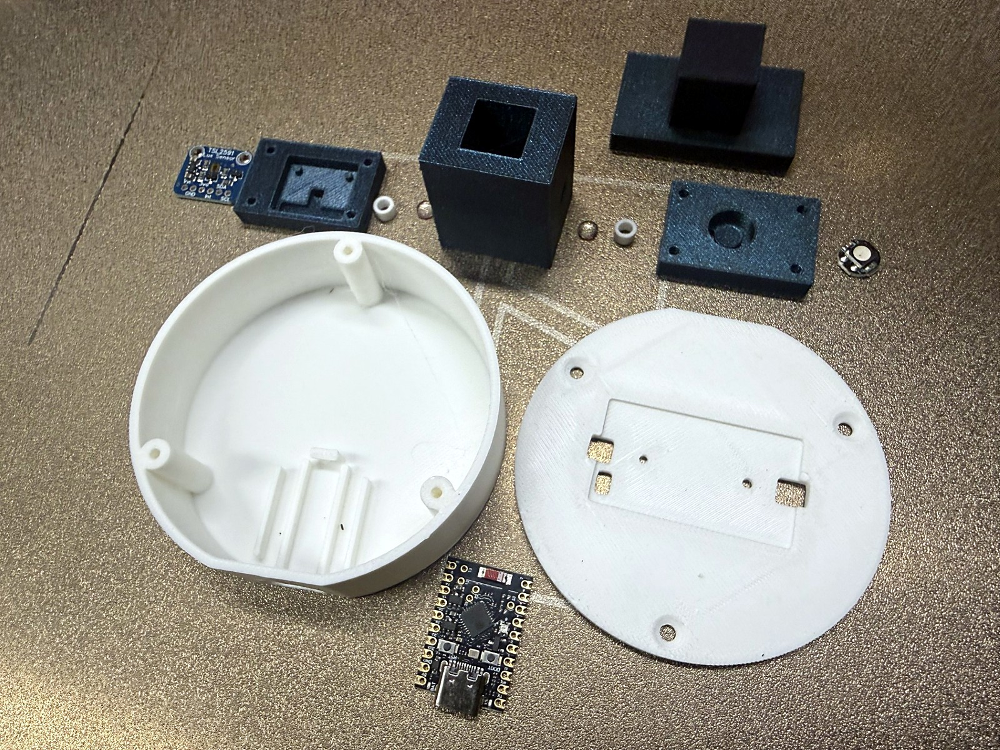
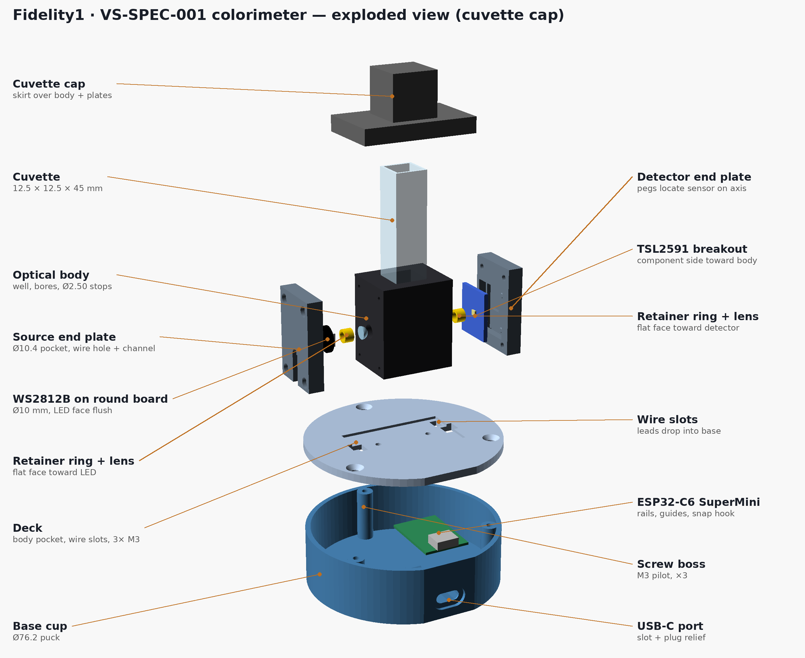
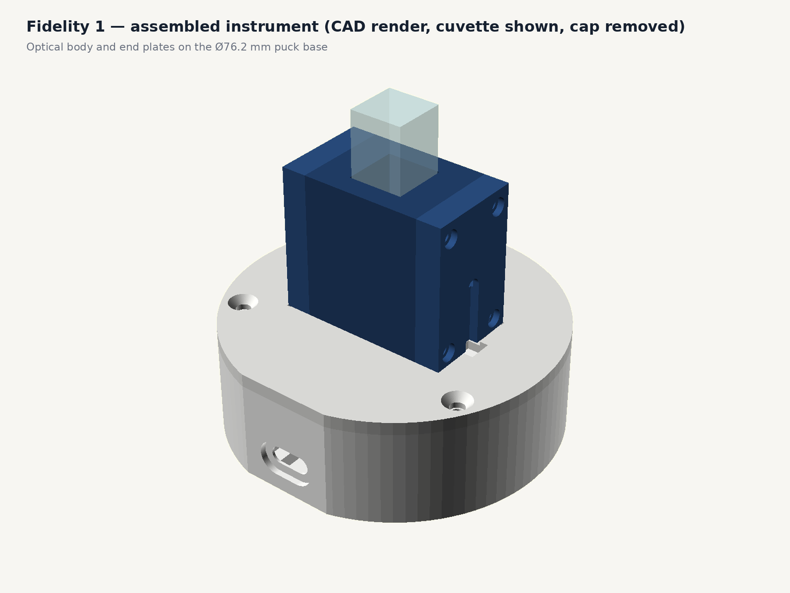
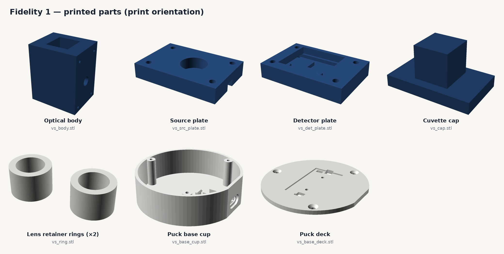

# Fidelity 1 — a ~$20 three-channel LED photometer with real collimating optics

Fidelity 1 is a 3D-printed benchtop photometer for a standard 10 mm cuvette. A single
WS2812B ("NeoPixel") RGB LED is the light source, two Ø5 mm half-ball lenses collimate the
beam across the cuvette, and an Adafruit TSL2591 light sensor is the detector. An ESP32-C6
SuperMini runs MicroPython firmware, and a small Python server plus browser UI on your PC
handles dark / blank / sample scans and absorbance.

It measures absorbance at three discrete wavelengths — **blue 465 nm, green 525 nm, red 630 nm**
— one LED die at a time. It is a photometer, not a spectrometer: nothing is measured between
the three bands (see [docs/specifications.md](docs/specifications.md)).

Built by Kevin Coleman Bynum, [Verusvia Scientific Consulting LLC](https://verus-via.com), as a
design study in AI-assisted instrument development. The optical body is a 3D-printable evolution
of the RGB-LED photometer idea from González-Laprea et al., *J. Chem. Educ.* 2025, adding true
collimating optics.

*The finished instrument: a USB-C cable is the only connection. The cuvette cap (right) is lifted off to load the sample.*

## Repository layout

| Path | Contents |
|---|---|
| `stl/` | Print-ready STL files (exported from `cad/vs_body.scad`) |
| `cad/vs_body.scad` | Parametric OpenSCAD source for every printed part |
| `firmware/` | MicroPython for the ESP32-C6: `main.py`, `tsl2591.py` |
| `software/` | PC side: `spectro_server.py`, `index.html`, `Fidelity1.bat` (Windows launcher) |
| `docs/` | [Assembly](docs/assembly.md), [wiring](docs/wiring.md), [specifications](docs/specifications.md), [bill of materials](docs/bom.md), [operation](docs/operation.md) |
| `images/` | CAD renders (add your build photos here — see `images/README.md`) |

## Quick start

1. **Print** the parts in [`stl/`](stl/) — see the print table in [docs/assembly.md](docs/assembly.md).
2. **Buy** the parts in [docs/bom.md](docs/bom.md).
3. **Assemble and wire** following [docs/assembly.md](docs/assembly.md) and [docs/wiring.md](docs/wiring.md).
4. **Flash** MicroPython onto the ESP32-C6 SuperMini and copy `firmware/main.py` and
   `firmware/tsl2591.py` to the board's root.
5. **Run** `software/Fidelity1.bat` (Windows) or `python software/spectro_server.py` — it installs
   `pyserial` if needed and opens the UI at <http://localhost:8080>.
6. Follow [docs/operation.md](docs/operation.md): connect, dark scan, blank scan, sample scan.

## Parts and layout

The printed parts and electronics before assembly:

Exploded view showing how everything fits together:

CAD renders of the assembly and of each printed part in its print orientation:

## Status and known limits

* Single-LED photometers show stray-light non-linearity at high absorbance. In the author's dye
  dilution tests, readings deviated measurably from linear above roughly 1 AU; keep samples
  below that for quantitative work.
* The RGB die is an indirect source: three emitters (~25, 35 and 20 nm FWHM), no
  monochromator. Colour-matched analytes work best.
* Software is "beta 2". Scans, dark/blank references and sample files are written next to
  `spectro_server.py`.

## A planned successor

Fidelity 2 keeps this body, puck and interface and swaps the detector/LED for an AS7341
multi-channel sensor and a high-CRI white LED. It is a separate project.

## License

Code is released under the MIT License (see [LICENSE](LICENSE)). Choose a separate license for
the CAD/STL files if you want one (for example CC BY 4.0) before publishing.
